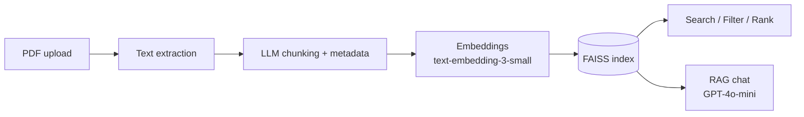

<div align="center">

# 🧑‍💼 HR CV Screening

**AI-powered CV screening web app: upload PDFs, filter, rank against a job description, and chat with your candidate pool.**


</div>

---

## ✨ Features

| | Feature | Description |
|---|---|---|
| 📊 | **Dashboard** | Total candidates, shortlisted count, average experience, processed CVs |
| 📤 | **Upload CVs** | Batch-upload PDF CVs and run the full AI processing pipeline |
| 👥 | **Candidates** | Cards with name, title, experience and skills, plus a full detail view |
| 🔎 | **Filtering** | Filter by minimum years of experience and skills |
| 🏆 | **Ranking** | Paste a job description and get a match score, summary, strengths and missing requirements |
| ✅ | **Shortlist workflow** | Statuses: New → Under Review → Shortlisted → Rejected |
| ⚖️ | **Comparison** | Compare candidates side by side |
| 💬 | **RAG Chat** | Ask natural-language questions about the CVs |

## 🧠 AI Pipeline



All models are called through [OpenRouter](https://openrouter.ai). Data is kept **in memory** (no database), so it resets when the server restarts.

## 🏗️ Project Structure

```
.
├── main.py            # FastAPI app: REST API + static frontend hosting
├── pipeline.py        # AI pipeline: extraction, chunking, embeddings, FAISS, ranking, chat
├── static/
│   ├── index.html     # Single-page UI (Dashboard / Upload / Candidates / Shortlist / Rank / Chat)
│   ├── style.css
│   └── app.js         # Frontend logic (fetch API)
├── requirements.txt
├── Dockerfile
└── .env.example
```

## 🚀 Getting Started

### Prerequisites
- Python 3.10+
- An [OpenRouter API key](https://openrouter.ai/keys)

### Run locally

```bash
git clone https://github.com/moazmohammed066-dotcom/hr-cv-screening.git
cd hr-cv-screening

python -m venv .venv
source .venv/bin/activate        # Windows: .venv\Scripts\activate
pip install -r requirements.txt

cp .env.example .env             # then put your OPENROUTER_API_KEY inside
uvicorn main:app --reload
```

Open <http://127.0.0.1:8000>. Interactive API docs are at <http://127.0.0.1:8000/docs>.

### Run with Docker

```bash
docker build -t hr-cv-screening .
docker run -p 8000:8000 --env-file .env hr-cv-screening
```

## 🔌 API Reference

| Action | Endpoint | Method |
|---|---|---|
| Dashboard stats | `/api/dashboard` | GET |
| Upload and process CVs | `/api/candidates/process` | POST (multipart) |
| List and filter | `/api/candidates?min_years=&skills=` | GET |
| Candidate details | `/api/candidates/{id}` | GET |
| Update status | `/api/candidates/{id}/status` | POST |
| Delete candidates | `/api/candidates/delete` | POST |
| Rank by job description | `/api/rank` | POST |
| Latest ranking | `/api/ranking/latest` | GET |
| RAG chat | `/api/chat` | POST |

## 🔒 Privacy & Security

- Keep your API key in `.env` only. It is git-ignored.
- CVs contain personal data. Uploaded files are stored in the OS temp folder and `*.pdf` is git-ignored, so never commit real CVs.

## 🗺️ Roadmap

- [ ] Persistent storage (SQLite / PostgreSQL)
- [ ] Authentication for HR users
- [ ] Export ranking results to CSV
- [ ] Automated tests

## 🤝 Contributing

See [CONTRIBUTING.md](CONTRIBUTING.md).

## 📄 License

Released under the [MIT License](LICENSE).
